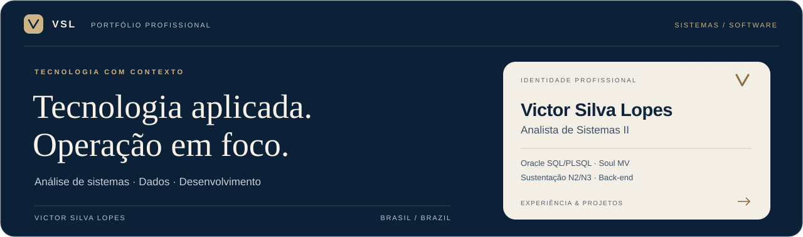
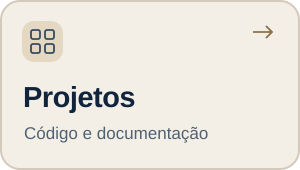

  

# Victor Silva Lopes

**Analista de Sistemas II · Oracle SQL/PLSQL · Soul MV · Sustentação N2/N3 · Back-end**

Conecto a operação hospitalar ao desenvolvimento de soluções: investigo incidentes, desenvolvo consultas e relatórios e apoio a continuidade das aplicações. Também construo APIs com **Node.js e Express** em projetos freelance.

## Acessos rápidos

  
  
  
  

[Projetos](#projetos-selecionados) · [Experiência](#experiência-e-foco) · [Currículo PT](docs/downloads/curriculo-victor.pdf) · [English résumé](docs/downloads/resume-international.pdf) · [LinkedIn](https://www.linkedin.com/in/victor-silva-lopes/)

Brasil · Remoto e híbrido conforme localização · CLT ou PJ · Inglês intermediário

---

## Projetos selecionados

### 01 / Controle Pessoal
**Uma interface financeira com atenção à acessibilidade.** Registro de entradas e saídas, saldo, armazenamento no navegador, ajustes de leitura e síntese de voz.

`HTML` `CSS` `JavaScript` `localStorage`  
[Explorar o código →](https://github.com/Bitoterror0/controle-pessoal) · Projeto pessoal

### 02 / Base de conhecimento
**Fontes organizadas para consultas com contexto.** Curadoria de referências, busca textual com SQLite FTS5 e snapshots de indicadores públicos agregados.

`Python` `SQLite FTS5` `Dados públicos`  
[Explorar a base →](https://github.com/Bitoterror0/base-conhecimento) · Ferramenta de pesquisa

### 03 / DevOps e automação
**Da aplicação ao ambiente de execução.** Estudo com API Flask, Docker, scripts SQL/PLSQL e GitHub Actions; o dashboard utiliza dados simulados.

`Python` `Flask` `Docker` `SQL` `GitHub Actions`  
[Explorar o laboratório →](https://github.com/Bitoterror0/devops-atividades-formativas-1.1) · Projeto acadêmico

### 04 / React + Firebase
**Fluxos de cadastro e autenticação em uma aplicação web.** Atividade acadêmica com React, Firebase Authentication e Cloud Firestore.

`React` `JavaScript` `Firebase` `Vite`  
[Explorar a aplicação →](https://github.com/Bitoterror0/react) · Projeto acadêmico; serviços externos sem validação nesta revisão

[Todos os repositórios →](https://github.com/Bitoterror0?tab=repositories) · [Inventário técnico e escopo dos projetos](docs/catalogo-publico.md)

## Experiência e foco

- **Sistemas hospitalares:** Analista de Sistemas II na Santa Casa de Misericórdia de Ribeirão Preto. Soul MV, Oracle SQL/PLSQL, incidentes e atendimento N2/N3; apoio a servidores, redes e backups.
- **Desenvolvimento back-end:** APIs com Node.js e Express, integradas a MongoDB e MySQL, em projetos freelance desde 2021.
- **Processos e segurança:** trajetória em auditoria interna no Grupo DPSP e em análise de sistemas e suporte de TI no Exército Brasileiro.

<strong>Formação e trajetória em detalhes</strong>

- **Santa Casa de Ribeirão Preto:** desde ago/2025; Analista de Sistemas II desde set/2026.
- **Grupo DPSP:** out/2023–set/2025; Auditor Interno Júnior desde mar/2025.
- **Exército Brasileiro:** atuação em análise de sistemas e suporte de TI, mar/2021–mar/2023.
- **Segurança da Informação — Anhembi Morumbi:** tecnólogo concluído em 2023.
- **Sistemas de Informação — UNINOVE:** bacharelado em andamento.
- **Desenvolvimento de Software — PUCPR:** pós-graduação em andamento.

Experiência profissional e projetos de estudo têm contextos distintos. O código público não expõe sistemas internos ou dados de pacientes.

## Currículo e contato

**[Currículo completo — PDF em português](docs/downloads/curriculo-victor.pdf)** · **[Résumé — PDF in English](docs/downloads/resume-international.pdf)**

Outros formatos e versões por área

- **Completo:** [Word](docs/downloads/curriculo-victor.docx) · [Texto](docs/downloads/curriculo-victor.txt)
- **Sistemas hospitalares:** [PDF](docs/downloads/curriculo-hospitais.pdf) · [Word](docs/downloads/curriculo-hospitais.docx) · [Texto](docs/downloads/curriculo-hospitais.txt)
- **Sistemas e setor financeiro:** [PDF](docs/downloads/curriculo-bancos.pdf) · [Word](docs/downloads/curriculo-bancos.docx) · [Texto](docs/downloads/curriculo-bancos.txt)
- **English résumé:** [Word](docs/downloads/resume-international.docx) · [Plain text](docs/downloads/resume-international.txt)
- [Todas as versões em ZIP](docs/downloads/curriculos-victor.zip)

Para oportunidades em análise de sistemas, sustentação de aplicações e desenvolvimento: **[vamos conversar no LinkedIn](https://www.linkedin.com/in/victor-silva-lopes/)**.

**Prefere uma experiência interativa?** [Entre no BIT//VERSE →](https://bitoterror0.github.io/Bitoterror0/) — portfólio com trajetória, projetos e currículo.

## Próximas ideias

**QueryLens · PulseOps · TraceLedger · RestoreProof · BridgeLab · ClarityDesk**

São propostas para explorar no futuro. [Conheça os nomes, objetivos e a ordem sugerida →](docs/ideias-projetos.md)

<strong>English / International opportunities</strong>

Systems Analyst II based in Brazil, working with hospital applications, Oracle SQL/PLSQL, Soul MV and N2/N3 support. I investigate incidents, develop queries and reports, and support application continuity. I also develop back-end APIs with Node.js and Express as a freelancer.

My background includes internal audit and IT support. I hold a degree in Information Security and am currently studying Information Systems and postgraduate Software Development. **English: intermediate.**

Open to systems analysis, application support and development opportunities.  
[Download my résumé](docs/downloads/resume-international.pdf) · [Connect on LinkedIn](https://www.linkedin.com/in/victor-silva-lopes/)

